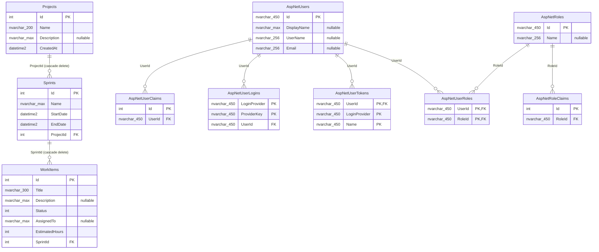

# DevTrack database design

## Scope and confidence

**Confirmed.** EF Core SQL Server migrations define two databases: domain `DevTrackDb` and Identity `DevTrackIdentityDb` ([Web appsettings.json](../src/DevTrack.Web/appsettings.json#L8), [DevTrackDbContext.cs](../src/DevTrack.Infrastructure/Data/DevTrackDbContext.cs#L8), [DevTrackIdentityDbContext.cs](../src/DevTrack.Infrastructure/Identity/DevTrackIdentityDbContext.cs#L9)). This document reports the checked-in EF migrations/snapshots, not a connected server. **Unknown:** whether migrations have been applied to any live LocalDB/Azure database or whether it has drifted; no live schema was queried.

SQL Server types, keys, indexes, and delete actions below are verified from the migrations. “CLR default” means a C# initializer used before insert, not a SQL `DEFAULT` constraint.

## ER diagram

The compact Identity attributes in the diagram are expanded below. The diagram uses actual table/field names; it labels `UserId`/`RoleId` conceptually despite Mermaid's limited composite-key notation.

## Domain schema: `DevTrackDb`

| Table | Column | SQL type | Null | Key/index/default |
|---|---|---:|:---:|---|
| `Projects` | `Id` | `int` | no | PK; `IDENTITY(1,1)` |
|  | `Name` | `nvarchar(200)` | no | required; max 200 |
|  | `Description` | `nvarchar(max)` | yes | — |
|  | `CreatedAt` | `datetime2` | no | no SQL default; CLR initializer is `DateTime.UtcNow` |
| `Sprints` | `Id` | `int` | no | PK; `IDENTITY(1,1)` |
|  | `Name` | `nvarchar(max)` | no | — |
|  | `StartDate` | `datetime2` | no | — |
|  | `EndDate` | `datetime2` | no | — |
|  | `ProjectId` | `int` | no | FK to `Projects.Id`; non-unique index `IX_Sprints_ProjectId` |
| `WorkItems` | `Id` | `int` | no | PK; `IDENTITY(1,1)` |
|  | `Title` | `nvarchar(300)` | no | required; max 300 |
|  | `Description` | `nvarchar(max)` | yes | — |
|  | `Status` | `int` | no | enum stored numerically (`Backlog=0`, `InProgress=1`, `InReview=2`, `Done=3`) |
|  | `AssignedTo` | `nvarchar(max)` | yes | free text; not an Identity FK |
|  | `EstimatedHours` | `int` | no | — |
|  | `SprintId` | `int` | no | FK to `Sprints.Id`; non-unique index `IX_WorkItems_SprintId` |

Source: [domain initial migration](../src/DevTrack.Infrastructure/Migrations/20260715205141_InitialCreate.cs#L14), [current domain snapshot](../src/DevTrack.Infrastructure/Migrations/DevTrackDbContextModelSnapshot.cs#L25), and [entities](../src/DevTrack.Core/Entities/WorkItem.cs#L14). There are no verified domain unique constraints, check constraints, computed columns, row-version columns, SQL defaults, or additional indexes.

`Projects` 1—many `Sprints` and `Sprints` 1—many `WorkItems`. Both child FKs are mandatory and cascade on delete, so deleting a project deletes its sprints and their work items; deleting a sprint deletes its work items ([snapshot](../src/DevTrack.Infrastructure/Migrations/DevTrackDbContextModelSnapshot.cs#L112)). Navigation references are nullable in C#, but that does not make their scalar FK optional.

## Identity schema: `DevTrackIdentityDb`

**Confirmed.** `ApplicationUser` adds nullable `DisplayName` to standard `IdentityUser` ([ApplicationUser.cs](../src/DevTrack.Infrastructure/Identity/ApplicationUser.cs#L8)). The initial Identity migration creates these tables:

| Table | Columns (type; `?` = nullable) | Keys / indexes |
|---|---|---|
| `AspNetRoles` | `Id nvarchar(450)`, `Name nvarchar(256)?`, `NormalizedName nvarchar(256)?`, `ConcurrencyStamp nvarchar(max)?` | PK `Id`; unique filtered `RoleNameIndex(NormalizedName)` |
| `AspNetUsers` | `Id nvarchar(450)`, `DisplayName nvarchar(max)?`, `UserName nvarchar(256)?`, `NormalizedUserName nvarchar(256)?`, `Email nvarchar(256)?`, `NormalizedEmail nvarchar(256)?`, `EmailConfirmed bit`, `PasswordHash nvarchar(max)?`, `SecurityStamp nvarchar(max)?`, `ConcurrencyStamp nvarchar(max)?`, `PhoneNumber nvarchar(max)?`, `PhoneNumberConfirmed bit`, `TwoFactorEnabled bit`, `LockoutEnd datetimeoffset?`, `LockoutEnabled bit`, `AccessFailedCount int` | PK `Id`; `EmailIndex(NormalizedEmail)` non-unique; unique filtered `UserNameIndex(NormalizedUserName)` |
| `AspNetRoleClaims` | `Id int IDENTITY`, `RoleId nvarchar(450)`, `ClaimType nvarchar(max)?`, `ClaimValue nvarchar(max)?` | PK `Id`; FK `RoleId` → roles, cascade; index `IX_AspNetRoleClaims_RoleId` |
| `AspNetUserClaims` | `Id int IDENTITY`, `UserId nvarchar(450)`, `ClaimType nvarchar(max)?`, `ClaimValue nvarchar(max)?` | PK `Id`; FK `UserId` → users, cascade; index `IX_AspNetUserClaims_UserId` |
| `AspNetUserLogins` | `LoginProvider nvarchar(450)`, `ProviderKey nvarchar(450)`, `ProviderDisplayName nvarchar(max)?`, `UserId nvarchar(450)` | composite PK `(LoginProvider, ProviderKey)`; FK to users, cascade; index `IX_AspNetUserLogins_UserId` |
| `AspNetUserRoles` | `UserId nvarchar(450)`, `RoleId nvarchar(450)` | composite PK `(UserId, RoleId)`; FKs to users and roles, both cascade; index `IX_AspNetUserRoles_RoleId` |
| `AspNetUserTokens` | `UserId nvarchar(450)`, `LoginProvider nvarchar(450)`, `Name nvarchar(450)`, `Value nvarchar(max)?` | composite PK `(UserId, LoginProvider, Name)`; FK to users, cascade |

Source: [Identity initial migration](../src/DevTrack.Infrastructure/Migrations/DevTrackIdentityDb/20260722092147_InitialIdentity.cs#L14). No SQL `DEFAULT` constraint is emitted in this migration; Identity code provides values when inserting required fields.

## Enforced constraints versus application-only rules

| Rule | Enforcement location | Consequence |
|---|---|---|
| Domain primary keys, required `Name`/`Title`, string limits, FK parent existence, cascade deletes | SQL migration / EF mapping | Applies to all writes reaching this schema. |
| Valid status values | API `EnumDataType` only; SQL is unrestricted `int` | Direct SQL or MVC binding can store an out-of-enum integer. |
| `EstimatedHours >= 0` | API request only | No database check; MVC/domain writes can be negative. |
| Sprint `EndDate >= StartDate` | API `SprintRequest.Validate` only | No database constraint and no MVC equivalent. |
| Project/sprint name non-blank | API annotations partially; SQL permits whitespace | No trim/non-blank database rule; MVC entities lack annotations. |
| Work item’s sprint exists and has not ended | `WorkItemService` | Both MVC/API work-item routes and AI selected-item route use it, but direct SQL does not. |
| Generated subtasks are 3–7, have non-empty title/description, 1–40 hours | Ollama service + MVC view model | Enforced before AI results are presented/created; not a database constraint. |
| Unique normalized user name/role name | Identity SQL indexes | Database-enforced when values are non-null. |

## Reads, writes, and transactions

Repositories are scoped through DI; generic reads use `FindAsync`/`ToListAsync`, while sprint/work-item display reads use `Include` to eager-load the parent navigation ([Repository.cs](../src/DevTrack.Infrastructure/Data/Repository.cs#L20), [SprintRepository.cs](../src/DevTrack.Infrastructure/Data/SprintRepository.cs#L18), [WorkItemRepository.cs](../src/DevTrack.Infrastructure/Data/WorkItemRepository.cs#L20)). Project details fetch only the project and do not `Include` sprints.

Project and sprint controllers/API controllers write one entity then call `SaveChangesAsync`. Work item creation/update first reads its sprint, then writes the item through `WorkItemService` ([WorkItemService.cs](../src/DevTrack.Application/Services/WorkItemService.cs#L33)). EF Core `SaveChangesAsync` is the only persistence boundary exposed by the generic repository ([Repository.cs](../src/DevTrack.Infrastructure/Data/Repository.cs#L30)). There is no explicit `BeginTransaction`, cross-context transaction, or batch operation in the repository. EF Core's default transaction behavior for each `SaveChangesAsync` applies; the AI selected-items loop therefore has a separate save/transaction per item rather than all-or-nothing semantics.

## Model/migration consistency and caveats

**Confirmed consistency:** domain entity property types/nullability and the current snapshot agree with the sole domain migration. `DbSet` names map to `Projects`, `Sprints`, and `WorkItems` as shown by the migration, not the stale comment that says default `ProjectEntities` naming ([DevTrackDbContext.cs](../src/DevTrack.Infrastructure/Data/DevTrackDbContext.cs#L18)).

**Implementation/documentation discrepancies:**

- The source comment in `ProjectsController` says `ModelState` checks data annotations, but `ProjectEntity` has none; the actual required/max-length rule comes from EF mapping ([ProjectsController.cs](../src/DevTrack.Web/Controllers/ProjectsController.cs#L45), [ProjectEntity.cs](../src/DevTrack.Core/Entities/ProjectEntity.cs#L5)).
- `OllamaOptions` defaults to `gemma4`, whereas both checked-in host settings override it with `llama3.2` ([OllamaOptions.cs](../src/DevTrack.Infrastructure/AI/OllamaOptions.cs#L3), [API appsettings.json](../src/DevTrack.Api/appsettings.json#L17)). UI error text says “Gemma 4”; that is not the supplied configuration ([AiPlannerController.cs](../src/DevTrack.Web/Controllers/AiPlannerController.cs#L58)).
- The live schema is unknown. A database created from a prior migration state, manually edited schema, or a different environment cannot be verified from this repository.
