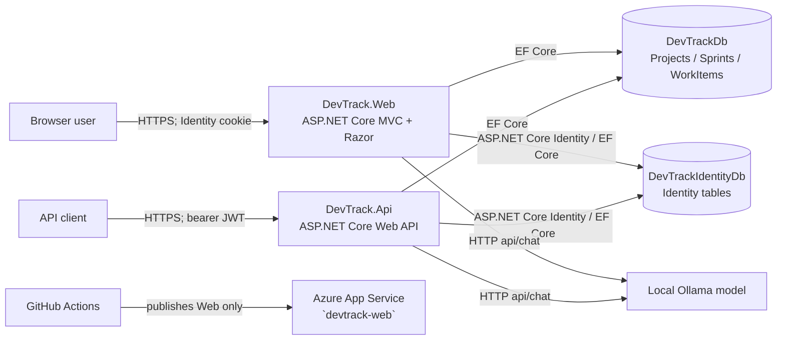
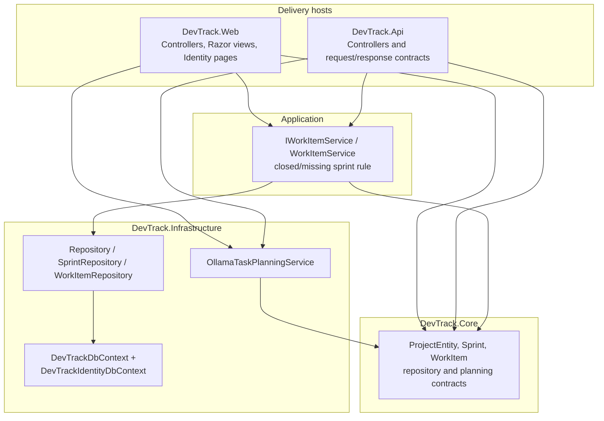

# DevTrack system architecture

## Evidence and terminology

This document describes the checked-in implementation, not an intended target architecture. **Confirmed** statements are backed by the source paths cited below. **Inference** identifies a reasonable interpretation rather than a recorded design decision. **Unknown** means the repository does not establish it. Line numbers refer to the repository state documented here.

## Purpose and user workflows

**Confirmed.** DevTrack is a small-team sprint and work-item tracker. It manages a hierarchy of projects, sprints, and work items; work items have a status, optional free-text assignee, and estimated hours ([ProjectEntity.cs](../src/DevTrack.Core/Entities/ProjectEntity.cs#L5), [Sprint.cs](../src/DevTrack.Core/Entities/Sprint.cs#L3), [WorkItem.cs](../src/DevTrack.Core/Entities/WorkItem.cs#L3)). It exposes both an interactive MVC application and a separate HTTP API host.

Main implemented workflows:

- An authenticated browser user lists, creates, edits, views, and (if an `Admin`) deletes projects, sprints, and work items. Deleting a project or sprint cascades to its children at the database level ([ProjectsController.cs](../src/DevTrack.Web/Controllers/ProjectsController.cs#L21), [SprintsController.cs](../src/DevTrack.Web/Controllers/SprintsController.cs#L27), [WorkItemsController.cs](../src/DevTrack.Web/Controllers/WorkItemsController.cs#L24)).
- A work item can be created or moved only into an existing sprint whose `EndDate` is not before the server's local current time; the service enforces that on both create and update ([WorkItemService.cs](../src/DevTrack.Application/Services/WorkItemService.cs#L33)).
- A browser user can ask the optional local AI planner for 3–7 proposed subtasks, edit/select them, then create selected suggestions as backlog work items. Suggestions are not persisted by `Generate`; `CreateSelected` creates each selected item via the normal work-item service ([AiPlannerController.cs](../src/DevTrack.Web/Controllers/AiPlannerController.cs#L25)).
- An API client registers, logs in to receive a one-hour JWT, then performs the equivalent project/sprint/work-item operations and asks for AI suggestions ([AuthController.cs](../src/DevTrack.Api/Controllers/AuthController.cs#L18), [WorkItemsController.cs](../src/DevTrack.Api/Controllers/WorkItemsController.cs#L9)).

## Technology stack

**Confirmed.** C# / .NET `net10.0` is used throughout ([DevTrack.Core.csproj](../src/DevTrack.Core/DevTrack.Core.csproj#L1)). The Web host is ASP.NET Core MVC with Razor Pages/Identity UI and static assets; the API is ASP.NET Core controllers with OpenAPI registered in development ([Web Program.cs](../src/DevTrack.Web/Program.cs#L33), [API Program.cs](../src/DevTrack.Api/Program.cs#L22)). The checked-in UI contains Bootstrap, jQuery, and jQuery Validation assets under `src/DevTrack.Web/wwwroot/lib`.

Persistence is Entity Framework Core SQL Server (package versions 10.0.10/10.0.11), configured against SQL Server LocalDB connection strings in the supplied settings ([Infrastructure.csproj](../src/DevTrack.Infrastructure/DevTrack.Infrastructure.csproj#L8), [Web appsettings.json](../src/DevTrack.Web/appsettings.json#L8)). Authentication uses ASP.NET Core Identity. The MVC host uses Identity cookies; the API uses `Microsoft.AspNetCore.Authentication.JwtBearer` and signed JWTs ([Web Program.cs](../src/DevTrack.Web/Program.cs#L22), [API Program.cs](../src/DevTrack.Api/Program.cs#L28)). Tests use xUnit with fakes/stub HTTP handlers ([WorkItemServiceTests.cs](../tests/DevTrack.Tests/WorkItemServiceTests.cs#L7)).

The optional AI integration is a typed `HttpClient` to a local Ollama-compatible `api/chat` endpoint. The supplied settings configure `http://localhost:11434`, model `llama3.2`, and a 180-second timeout ([OllamaTaskPlanningService.cs](../src/DevTrack.Infrastructure/AI/OllamaTaskPlanningService.cs#L48), [Web appsettings.json](../src/DevTrack.Web/appsettings.json#L13)).

`Azure.Core` and `Azure.Identity` are package references in the Web project, but no checked-in source code imports or calls them; they are not evidence of an Azure SDK integration ([DevTrack.Web.csproj](../src/DevTrack.Web/DevTrack.Web.csproj#L9)).

## Context and components



**Confirmed.** The API and Web hosts compose the same repositories, work-item service, both DbContexts, and task-planning client ([Web Program.cs](../src/DevTrack.Web/Program.cs#L16), [API Program.cs](../src/DevTrack.Api/Program.cs#L25)). They target the same configured databases. There is no checked-in SPA, message broker, cache, background worker, external email provider, or API deployment workflow. The email sender only logs message content ([DevTrackEmailSender.cs](../src/DevTrack.Web/Services/DevTrackEmailSender.cs#L14)).



**Confirmed.** `Core` has no project reference; `Application` and `Infrastructure` reference Core; Web/API reference the other layers ([Application.csproj](../src/DevTrack.Application/DevTrack.Application.csproj#L9), [Infrastructure.csproj](../src/DevTrack.Infrastructure/DevTrack.Infrastructure.csproj#L3), [Web.csproj](../src/DevTrack.Web/DevTrack.Web.csproj#L3), [Api.csproj](../src/DevTrack.Api/DevTrack.Api.csproj#L15)). Note that this is a pragmatic layered design, not strict Clean Architecture: hosts directly use Core repository contracts and Infrastructure task-planning contracts, and project/sprint CRUD orchestration remains in controllers.

## Important traced workflow: MVC work-item creation

```mermaid
sequenceDiagram
    actor U as Signed-in user
    participant C as WorkItemsController
    participant S as WorkItemService
    participant SR as ISprintRepository
    participant WR as IWorkItemRepository
    participant DB as SQL Server / DevTrackDb
    U->>C: POST /WorkItems/Create (anti-forgery token, WorkItem)
    C->>C: ModelState.IsValid
    C->>S: CreateAsync(workItem)
    S->>SR: GetByIdAsync(SprintId)
    SR->>DB: SELECT Sprint
    DB-->>SR: Sprint / null
    alt missing or ended sprint
      S-->>C: InvalidOperationException
      C->>C: Add model-level error; reload sprint list
      C-->>U: 200 form with validation message
    else valid sprint
      S->>WR: AddAsync(workItem)
      S->>WR: SaveChangesAsync()
      WR->>DB: INSERT WorkItems; EF transaction for SaveChanges
      DB-->>WR: commit
      S-->>C: complete
      C-->>U: 302 redirect to Index
    end
```

**Confirmed.** This is the actual call path ([WorkItemsController.cs](../src/DevTrack.Web/Controllers/WorkItemsController.cs#L47), [WorkItemService.cs](../src/DevTrack.Application/Services/WorkItemService.cs#L33), [Repository.cs](../src/DevTrack.Infrastructure/Data/Repository.cs#L20)). EF Core's `SaveChangesAsync` normally wraps the SQL it issues in a transaction when needed; no explicit application transaction is present. **Limitation:** AI selected items call this service once per item, so a later failure can leave earlier selected items persisted ([AiPlannerController.cs](../src/DevTrack.Web/Controllers/AiPlannerController.cs#L93)).

## Security, validation, and error handling

### Authentication and authorization

**Confirmed.** MVC registers Identity with an EF store and cookie login/access-denied paths. A global MVC authorization filter requires an authenticated user; listed Identity account endpoints and Home/Privacy are anonymous. `Admin` and `TeamMember` roles are created at Web/API startup. The `AdminOnly` policy guards every implemented delete action; create/read/edit only require sign-in ([Web Program.cs](../src/DevTrack.Web/Program.cs#L22), [Web Program.cs](../src/DevTrack.Web/Program.cs#L66), [ProjectsController.cs](../src/DevTrack.Web/Controllers/ProjectsController.cs#L80)).

The API is bearer-authenticated. Registration creates an already-confirmed Identity user and adds `TeamMember`; login verifies the password, adds user/role claims, and issues a one-hour HMAC-SHA256 JWT. Validation checks issuer, audience, signing key, and lifetime with a one-minute clock skew ([AuthController.cs](../src/DevTrack.Api/Controllers/AuthController.cs#L18), [API Program.cs](../src/DevTrack.Api/Program.cs#L33)). API CRUD and planning controllers have `[Authorize]`; delete actions require `AdminOnly` ([Projects API controller](../src/DevTrack.Api/Controllers/ProjectsController.cs#L9)).

**Confirmed limitation.** Domain records have no owner, organization, or user foreign key. Therefore authorization is role-wide, not resource/tenant scoped: any authenticated user can access all domain records exposed by these endpoints.

### Validation

**Confirmed.** API `[ApiController]` plus request data annotations produces automatic 400 validation responses; API contracts constrain project name (200), work-item title (300), ID ranges, estimates, and sprint date ordering ([Projects.cs](../src/DevTrack.Api/Contracts/Projects.cs#L5), [Sprints.cs](../src/DevTrack.Api/Contracts/Sprints.cs#L5), [WorkItems.cs](../src/DevTrack.Api/Contracts/WorkItems.cs#L6)). The MVC AI view model has analogous constraints ([AiPlannerViewModel.cs](../src/DevTrack.Web/Models/AiPlannerViewModel.cs#L6)).

Entity Framework enforces required/max-length mappings for `Projects.Name` and `WorkItems.Title`, and SQL foreign keys enforce parent existence ([DevTrackDbContext.cs](../src/DevTrack.Infrastructure/Data/DevTrackDbContext.cs#L29)). **Important difference:** the MVC project/sprint/work-item CRUD binds domain entities, which do not carry data annotations. Consequently, MVC `ModelState` does not enforce those API DTO rules; the database or service rule may be the first rejection. MVC project/sprint creation also does not independently test referenced parents or sprint date order.

Every MVC state-changing action has `[ValidateAntiForgeryToken]`; Razor form tag helpers generate tokens for normal forms ([AiPlannerController.cs](../src/DevTrack.Web/Controllers/AiPlannerController.cs#L25), [Projects Create view](../src/DevTrack.Web/Views/Projects/Create.cshtml#L9)). `Bind` limits project/sprint create/edit fields, but work-item actions bind the entity directly.

### Failures

**Confirmed.** The Web production pipeline uses `/Home/Error` and HSTS; API uses Problem Details and an exception handler ([Web Program.cs](../src/DevTrack.Web/Program.cs#L81), [API Program.cs](../src/DevTrack.Api/Program.cs#L22)). Missing entities commonly return 404; mismatched MVC IDs return 400 or 404 depending on controller; business-rule exceptions become MVC model errors or API `ValidationProblemDetails` ([WorkItemsController.cs](../src/DevTrack.Web/Controllers/WorkItemsController.cs#L50), [WorkItems API controller](../src/DevTrack.Api/Controllers/WorkItemsController.cs#L25)). AI connection, timeout, and malformed-output failures are logged and safely returned as UI errors or HTTP 503 ([TaskSuggestionsController.cs](../src/DevTrack.Api/Controllers/TaskSuggestionsController.cs#L46)).

## Deployment evidence and trade-offs

**Confirmed.** GitHub Actions runs restore, Release build, tests with coverage collection, publishes `DevTrack.Web`, then non-PR runs deploy it to Azure App Service named `devtrack-web` using a publish-profile secret ([ci-cd.yml](../.github/workflows/ci-cd.yml#L13)). The workflow does not publish/deploy the API, apply database migrations, provision infrastructure, or perform a health check. **Unknown:** the actual production URL, Azure resource configuration, runtime settings, database hosting, migration process, and whether the deployed Web app can reach Ollama.

**Observable trade-offs / inferences:**

- **Inference:** two contexts/databases isolate Identity schema and credential-related data from domain data. This adds operational work: both must be migrated/backed up, and no cross-context transaction is implemented.
- **Inference:** thin repositories make current code easy to fake in unit tests, but duplicate some EF Core abstraction and return unpaged, materialized lists ([Repository.cs](../src/DevTrack.Infrastructure/Data/Repository.cs#L9)).
- **Confirmed limitation:** the configured JWT signing key appears in the checked-in API settings ([API appsettings.json](../src/DevTrack.Api/appsettings.json#L12)); it must be replaced/managed outside source for a secure deployment.
- **Confirmed limitation:** `DateTime.Now` drives the closed-sprint rule, so time zone/boundary semantics are implicit rather than injected/test-controlled ([WorkItemService.cs](../src/DevTrack.Application/Services/WorkItemService.cs#L44)).
- **Confirmed limitation:** the local planner validates shape and estimates but generated text remains model output; it has no rate limit, retry/circuit breaker, audit trail, or provider authentication in this codebase.

## Supporting-document discrepancies

`DevTrack_Interview_Brief.md` is broadly consistent about layers, the work-item rule, roles, JWT, and AI review flow. It should not be treated as proof of deployment state: its statement that the API key is secret configuration conflicts with the checked-in development-style JWT key, and its delivery narrative should be qualified because the checked-in workflow deploys **only Web**. Its suggested phrase “production-level” should be avoided: repository evidence instead supports a learning project with an Azure Web deployment pipeline and the limitations above. The README's architecture tree names `DevTrack.sln`, while the checked-in solution is `DevTrack.slnx`; use the latter in commands and demonstrations.
